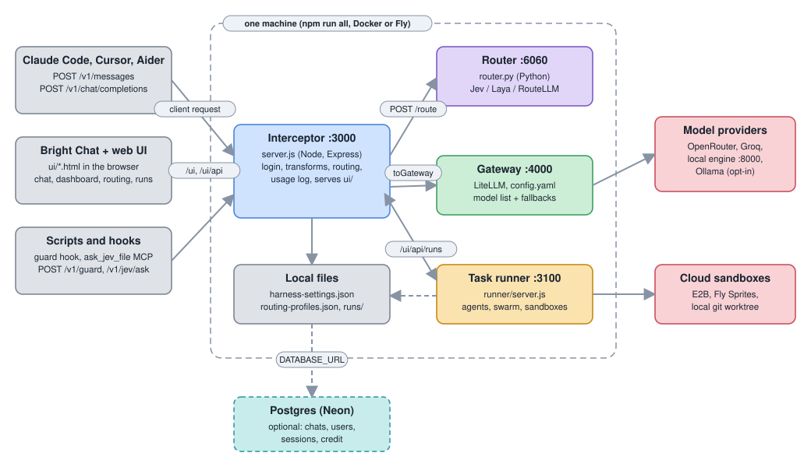
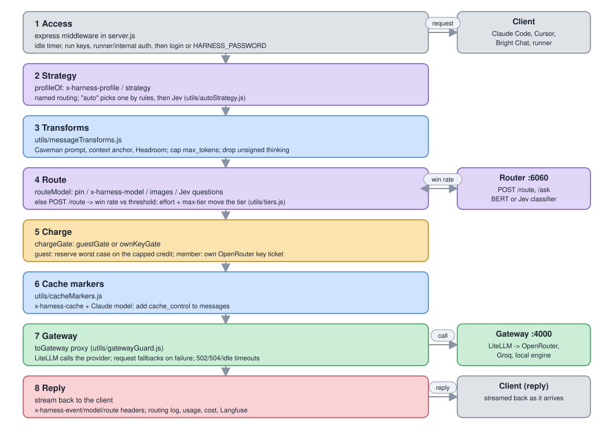
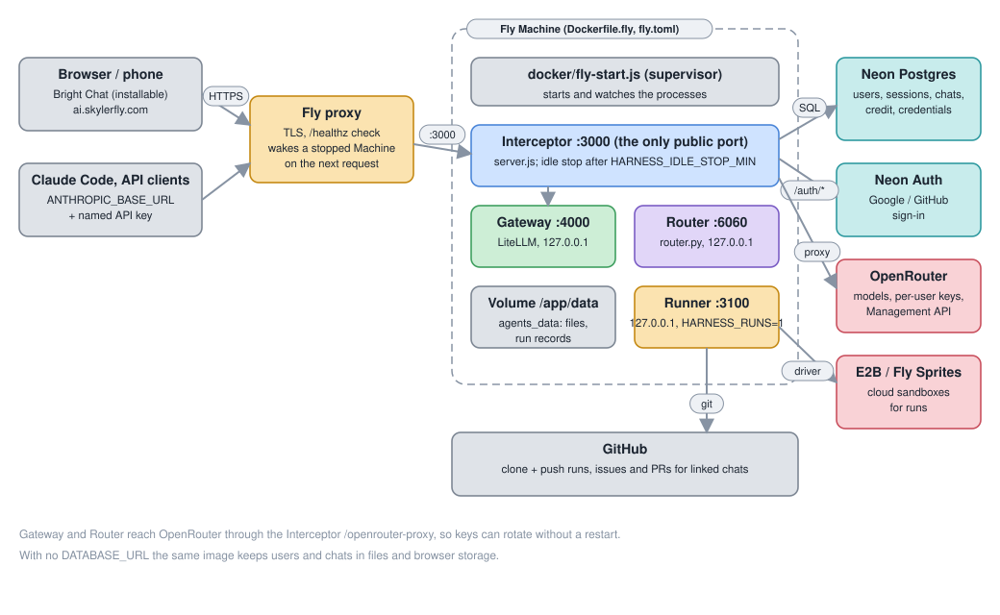
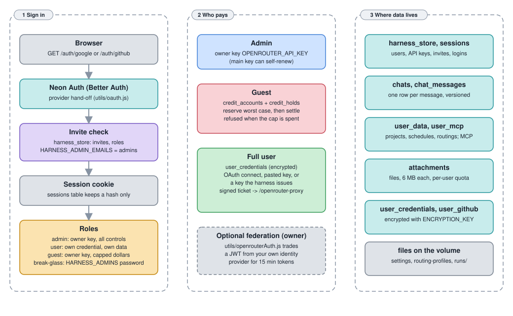

# Architecture

A map of how the harness fits together and where each concern lives. It is a map, not a manual: each section links to the page in `docs/` that has the detail. The older [Architecture and files](docs/architecture.md) page has the per-file table and the setup reference.

## The parts

Everything a client talks to goes through one Node process, the **Interceptor** (`server.js`, port 3000). It serves the web UI, checks who you are, compresses and routes each request, and forwards it to the **Gateway** (LiteLLM, port 4000). The **Router** (`router.py`, port 6060) only answers "strong or weak model?". The **task runner** (`runner/`, port 3100) is a separate process for agents that do a whole task.

| Process | Entry point | Job | Detail |
|---|---|---|---|
| Interceptor :3000 | `server.js` | Login, transforms, routing decision, usage log, web UI and its `/ui/api/*`, command guard, MCP tools | [Routing](docs/routing.md), [Chat page](docs/chat.md) |
| Router :6060 | `router.py` | Classifier (Jev or Laya through `systemone`, or `routellm`): `/route`, `/ask`, `/health`, `/admin/*` | [Configuration](docs/configuration.md) |
| Gateway :4000 | `config.yaml` (LiteLLM; `docker/gateway-start.py` in containers) | Model list, provider keys, fallbacks, timeouts | [Configuration](docs/configuration.md) |
| Task runner :3100 | `runner/server.js` | Runs, agents, workflows, swarm, sandboxes. The Interceptor proxies `/ui/api/runs` to it | [Task runner](docs/task-runner.md) |
| Local engine :8000, Ollama | `launch-local.sh`, `npm run all:ollama` | Optional local models | [Running the stack](docs/running-the-stack.md) |

`npm run all` (`scripts/start-all.js`) starts the Gateway, Router and Interceptor from `.venv` in one window and shares `RUNNER_TOKEN` with the runner. Docker (`docker-compose.yml`, `docker/`) runs the same parts as containers, and `docker/fly-start.js` runs them in one Fly Machine. See [Run it on a server](docs/server-docker.md) and [Run it on Fly.io](docs/fly.md).

## Request flow

A request arrives as OpenAI (`/v1/chat/completions`) or Anthropic (`/v1/messages`) format. The two handlers at the bottom of `server.js` run the same steps. The Router is asked only when nothing else has already decided the model.

- **Access**: `utils/access.js`, `utils/login.js`, `utils/users.js`; run keys (`utils/runKeys.js`) and loopback calls from the runner or server schedules (`utils/runnerAuth.js`, `utils/internalAuth.js`). Details in [Named logins](docs/logins.md).
- **Strategy** (a "routing" or "profile"): `utils/profiles.js`, picked by `x-harness-profile`; `auto` is `utils/autoStrategy.js`. A member's own routings are in `utils/userPrefs.js`.
- **Transforms**: `utils/messageTransforms.js` (Caveman prompt, context anchor, Headroom), `caveman-compress.js` for standing files.
- **Route**: `routeModel` in `server.js`. Order: `x-harness-model` header, strategy pin, images model, extra Jev questions (`utils/jevQuestions.js`), then Router `/route` (win rate against a threshold). `utils/tiers.js` adds mid and frontier tiers, `x-harness-effort` and `x-harness-max-tier`. Requests with tools use the `*_tools` outputs.
- **Charge** (hosted only): guests reserve against a capped credit (`utils/credit.js`); full users use their own OpenRouter credential (`utils/credentialTicket.js`).
- **Cache markers**: `utils/cacheMarkers.js`, for Claude models when the chat page asks.
- **Gateway**: `utils/gatewayGuard.js` bounds waits and shapes errors. LiteLLM applies `fallbacks` from `config.yaml` or the strategy.
- **Reply**: response headers `x-harness-event`, `x-harness-model`, `x-harness-route`; `utils/monitor.js` (routing log and live feed), `utils/usage.js` (per person; `utils/usageDb.js` with a database) and `utils/runCost.js` for the Usage page, `utils/langfuse.js`.

## Web UI

Static pages in `ui/`, served by the Interceptor at `/ui` with no build step. Every page loads `ui/dialogs.js` first and `ui/bright.css` / `ui/bright.js` for the shared look, and `ui/mobile.css` last for phones. The pages bar is built by `ui/nav.js` (styles in `ui/nav.css`) from a `<nav data-site-nav>` placeholder, so the links, active page, account menu and phone menu live in one place; add a page there, not in each HTML file.

| Page | Files | Purpose |
|---|---|---|
| Bright Chat | `chat.html`, `chat.js`, `chat.css`, `markdown.js`, `chatmerge.js`, `schedule.js` | Chats, projects, skills, tools, voice, schedules, cache timers (`cachetimer.js`), imports from Claude Code (`utils/claudeKit.js`), skills from a link (`utils/remoteSkills.js`) |
| Dashboard | `index.html` | Health, routing log, recent chats, usage summary, command guard |
| Routing | `routing.html`, `routing.js`, `autoroute.js`, `touch.js` | Node editor for routings, models, fallbacks, Auto-route (touch: `touch.js`) |
| Settings | `settings.html` | Interceptor and Router settings, notifications (`notify.js`) |
| Usage | `usage.html`, `usage.js`, `costs.js`; admins: `usage-users.html`, `usage-users.js`, `userUsage.js` | Cost and savings per layer; your own requests with logins on, everyone's per person for admins |
| Tools | `tools.html`, `tools.js` | MCP servers, with a guided setup for catalog entries that need a key or folder |
| Runs, Agents | `runs.html`, `agents.html`, `agents.js`, `agentBoard.js`, `apps.js` | Task runner, agents, in-app apps (`agent-widget.js`) |
| Apps | `apps.html`, `appspage.js`, `templates/` | The Apps page: your apps (Edit reuses the import dialog), new ones from a template (`runner/templates.js`), and existing repos (`runner/importDetect.js`, Import existing app) |
| Prompts | `prompts.html`, `prompts.js`, `promptlib.js` (`window.Prompts`, also used by the Agents page) | Saved prompts for agents: variables, versions, starters, "improve" through a model; server side `utils/prompts.js` (`user_data` key `prompts`, or `prompts.json`) |
| Users | `users.html`, `users.js` | Logins, invites, guests, credentials |

`ui/manifest.webmanifest` and `ui/sw.js` make it an installable app ([Phone and app](docs/phone-and-app.md)). Page behaviour is in [Chat page](docs/chat.md) and [Dashboard, settings and usage](docs/control-ui.md).

## Task runner

`runner/server.js` exposes runs over HTTP. `runner/runs.js` manages them, `runner/agent.js` is the model loop, `runner/tools.js` the tool set (each call checked through `/v1/guard`, with approvals on the Runs page), and `runner/sandbox.js` the sandbox drivers: local git worktree, E2B, and Fly Sprites (`runner/sprites.js`). On top: `workflows/*.json` with `utils/workflows.js`, `runner/swarm.js` (planner, parallel workers, merge, reviewer), `runner/escalate.js` (retry on a stronger tier), `runner/tickets.js` and `runner/ticketFiles.js` (wayfinder tickets), `runner/apps.js`, `runner/preview.js` and `runner/ship.js` (in-app agents: preview, ship as PR, undo), `runner/github.js`, and `runner/chatdev.js`. See [Task runner](docs/task-runner.md) and [ChatDev](docs/chatdev.md).

## Hosted setup

On Fly, one Machine runs the Gateway, Router, Interceptor and, with `HARNESS_RUNS=1`, the runner. Only the Interceptor is public. The Machine sleeps after `HARNESS_IDLE_STOP_MIN` idle minutes (`utils/idleStop.js`) and Fly wakes it on the next request. State lives in Neon and on one volume.

Files: `Dockerfile.fly`, `fly.toml`, `docker/fly-start.js`, `neon.ts`. Plans and reasoning: [hosted app plan](docs/hosted-app-plan.md). Steps: [Run it on Fly.io](docs/fly.md), [Neon](docs/neon.md).

## Sign-in, billing and storage

Sign-in is invite-only. `utils/oauth.js` hands Google or GitHub sign-in to Neon Auth and the harness decides who may enter. Named logins and a break-glass admin password (`HARNESS_ADMINS`) work without a database.

| Concern | Where |
|---|---|
| Who pays | Admins use the owner's key. Guests: `utils/credit.js`. Full users: their own key (`utils/userCredentials.js`), from OpenRouter OAuth (`utils/openrouterOAuth.js`), pasted, or issued through the Management API (`utils/openrouterKeys.js`). The owner's key can renew itself (`utils/mainKey.js`). |
| Credentials reach OpenRouter | Gateway and Router call `/openrouter-proxy` (`utils/openrouterAuth.js`); a signed ticket names the person. Optional owner-level workload identity federation (a JWT from your own identity provider, 15-minute tokens): also `utils/openrouterAuth.js`. |
| GitHub | `utils/githubOAuth.js` (GitHub App or OAuth App), the person's token in `utils/userGithub.js`, repo tools in `utils/githubApi.js` (hosted) and `utils/repoTools.js` (local) |
| Database | `utils/db.js` (optional; `DATABASE_URL`), `migrations/*.sql` applied by `npm run migrate`, stores in `utils/pgStore.js`, `utils/pgSessions.js`, `utils/chatSync.js`, `utils/usageDb.js` |
| Chats | The page works from `localStorage` and syncs to Postgres: `chats` (order, version) and `chat_messages` (one row per message), plus `user_data` for projects, skills, commands and schedules. Conflicts return 409 and the page merges. |
| Attachments | `attachments` table (`utils/attachments.js`); messages keep stubs |
| Schedules | The page's schedules; with a database `utils/serverSchedules.js` runs due ones with every tab closed |
| Files (no database) | `users.json`, `harness-usage.json`, `harness-settings.json`, `routing-profiles.json`, `model-stats.json`, `runs/` |
| Secrets at rest | `utils/secrets.js` (`ENCRYPTION_KEY`) |

## MCP tools and the Jev guard

- **Chat tools**: `utils/mcp.js` loads `mcp-servers.json` (same format as `.mcp.json`); `utils/mcpAdmin.js` and `utils/mcpCatalog.js` back the Tools page; members get remote-only servers (`utils/userMcp.js`, table `user_mcp`). See [Chat page](docs/chat.md).
- **Command guard**: `POST /v1/guard` (`utils/guard.js`, `guard-rules.json`) allows or asks about a command; Jev answers yes/no questions through the Router `/ask`. The Claude Code hook is `.claude/hooks/guard.js`. See [Claude Code and agent tools](docs/claude-code.md).
- **`ask_jev_file`**: `scripts/jev-files-mcp.js`, `utils/jevFiles.js`, `utils/jevAsk.js`.

## Testing

Node tests in `test/*.test.js` (`node --test`), Router tests in `test/test_router*.py` (pytest). While developing run `npm run test:for` (only tests that mention changed files); `test:fast` and `test:slow` split the suite; run `npm test` once before a PR. Use `fakeGateway()` from `test/helpers/stubs.js`. The index of which tests cover what is in [docs/development.md](docs/development.md). `CLAUDE.md` has the working rules for this repo.

## Where to look

| I want to change... | Start here |
|---|---|
| How a model is picked | `routeModel` in `server.js`, `utils/tiers.js`, `utils/profiles.js`, `router.py` |
| What gets sent upstream | `utils/messageTransforms.js`, `utils/cacheMarkers.js` |
| Provider models and fallbacks | `config.yaml`, `utils/gatewayConfig.js` |
| Who can sign in or pays | `utils/users.js`, `utils/oauth.js`, `utils/credit.js`, `utils/userCredentials.js` |
| A UI page | `ui/<page>.html` and its `.js` |
| Database tables | `migrations/`, `utils/chatSync.js` |
| Agent runs | `runner/` |
| Deployment | `Dockerfile*`, `docker/`, `fly.toml`, `scripts/start-all.js` |
